# Architecture Direction

The selected architecture remains a narrow GitHub-first C# review product. [CR1/CR2](../90_roadmap/cr1-cr2-plan.md) owns the changed direction and acceptance boundaries:

1. CR1 moves generic agent/provider execution and runtime context to exact-version SolusAgent packages while APR retains review, state and publication authority.
2. CR1 replaces the production AOT target with a complete framework-dependent managed .NET 10 DLL archive, invoked through a trusted compatible runtime, and adapts the existing Action.
3. CR2 makes the .NET CLI the sole product entry, with a thin composite Action and explicit official artifact-bridge disposition.
4. Credential/data/capability boundaries remain explicit; a worker process needs separate fault, resource, extension or trust evidence.

The [runtime rebaseline](./agent-runtime-rebaseline.md) retains the earlier R-series decisions and current implementation contracts. Its project-owned generic loop, AOT and permanent Node-entry assumptions do not govern new migration design.

## Status

Current production uses the five pinned Solus `0.1.0-internal.4` packages, APR-owned review/state/publication boundaries and a complete managed .NET 10 publish tree. The APR generic loop/chat executor, old DeepSeek transport, project SESSION and production AOT packaging are retired. The nested composite and internal Node 24 Actions implement managed exact-map resolution, trusted runtime/tree descriptor launch, seven raw inputs and fourteen outputs. C# `run` owns product input/default/result semantics and REST; Node retains only the bounded official SDK upload capability, process safety and presentation. The [final CR2 record](cr2-technical-acceptance.md) binds original-archive, actual Runner and hosted evidence separately. Its map remains null: there is no experimental release or supported downstream installation. The [final CR1 record](../90_roadmap/cr1-cr2-plan.md#final-cr1-technical-acceptance) identifies the qualified source, package/profile, archive and Action proofs and their limitations.

R1-R4 completed the legacy removal and C# Host/state/publication cutover; see the [R4 handoff](./r4-migration-cutover-handoff.md). R5's earlier live quality remains inconclusive. [R6 final acceptance](https://github.com/SolusQuest/agentic-pr-review/issues/271#issuecomment-5928401721) accepts bounded engineering/evaluation closeout while preserving native-history, live-prefix, formal-regression, billing and default-capacity unknowns. These results do not qualify migrated execution.

Keep current operating contracts until replacement; new migration work follows CR1/CR2 with named replacement/retirement evidence. Remaining R7 first-candidate work follows both and re-refinement of affected unfinished contracts. Formal public/default graduation remains a later maintainer decision.

## Architecture Decision And Rationale

The project keeps C# product ownership while reusing SolusAgent generic execution and the managed distribution approach already demonstrated by ContractScribe. Broad cross-language product contracts remain outside the engineering goals.

The prior split proved:

- deterministic process invocation;
- Native AOT feasibility;
- schema and fixture discipline;
- durable state selection and acceptance;
- strict provider parsing;
- canonical prefix materialization;
- fail-closed side-effect barriers.

It also created substantial duplicate business logic and validation across TypeScript and C#. The next product risk is not whether another sidecar can be validated in two languages. It is whether a bounded, stateful agent can use repository tools to produce better grounded reviews across workflow runs.

The architecture therefore optimizes for:

- one business implementation language;
- a real agent vertical slice before further broad contract work;
- explicit credential data-flow and capability isolation;
- deterministic host-owned publication;
- simple pre-1.0 compatibility rules;
- reusable safety invariants without preserving unnecessary source-language duplication.

## Target Runtime Boundary

```mermaid
flowchart LR
    Wrapper["Thin composite<br/>prepare, launch and post"] --> App["Managed .NET CLI<br/>verified publish tree"]
    App --> Host["APR Host<br/>GitHub, state and publisher authority"]
    Host -->|"sanitized context and narrow capabilities"| Product["APR review product<br/>policy, tools and evidence acceptance"]
    Product --> Runtime["SolusAgent<br/>generic execution and runtime context"]
    Runtime --> Provider["Provider transport<br/>provider-only credential"]
    Runtime -->|"untrusted outcomes and restricted context"| Product
    Product -->|"candidate result and state"| Host
```

The model cannot inspect process memory. It observes only provider requests and tool results deliberately sent to it. For the initial trusted, project-owned tool set, security therefore depends on explicit data flow, narrow capabilities, separate credential-bearing clients, and canary tests—not on a mandatory Host/Agent process split.

Separate `csproj` files can enforce dependency direction but are not a security boundary. A future same-binary worker mode may add kill and resource isolation, but a second process is not a complete sandbox by itself.

## Thin Node.js Wrapper Responsibilities

The current composite and internal Node boundary own:

- Action input and output bridging;
- secret masking;
- .NET payload resolution and checksum verification;
- cancellation forwarding;
- upload-only official JavaScript artifact SDK execution with confined staging and independently confirmed subprocess/channel lifetime;
- step annotations and summary forwarding;
- final exit-code forwarding.

It must not own GitHub business operations, prompts, provider selection semantics, tools, findings, session compatibility, prefix construction, or publisher policy. CR2 has consolidated product input/configuration and result/accounting semantics in C#, with artifact REST in the live C# store. The [retirement/residual inventory](cr2-technical-acceptance.md#retirement-and-residual-consumers) names replacements and historical fixture consumers; no broad bridge production fallback remains.

## .NET ActionHost Responsibilities

The trusted host owns:

- GitHub event and input interpretation;
- PR metadata, changed-file, diff, and tracked-file snapshots;
- GitHub REST reads and writes;
- state selection, provenance, acceptance, and stale-writer protection;
- in-process Agent invocation through a narrow typed request;
- candidate result and state validation;
- finding fingerprints, duplicate suppression, line mapping, and caps;
- sticky and inline publication;
- the final side-effect and stale-head barrier.

The Host may receive GitHub and Actions service credentials. The Agent may not receive those credentials or credential-bearing objects.

## .NET Review Agent Responsibilities

APR's review layer owns trusted instructions/policy, domain tool definitions and validation, admitted evidence, product budgets, findings acceptance and interpretation of incomplete outcomes. Solus supplies generic loop/provider/tool execution mechanics and runtime context. The selected limits and result/context integration are recorded in the final CR1 acceptance; neither a package install nor a successful shared-runtime result alone establishes product correctness.

Agent orchestration receives no `ActionConfig`, `HostSecrets`, GitHub/Actions client or credential, environment abstraction, generic `HttpClient`, service locator or shell/process capability. The provider credential remains in a separate narrow transport with allowlisted endpoint and bounded request/response handling. GitHub and provider clients do not share credentials or handlers.

Restricted context capture/admission is separate from APR storage/lineage and publication acceptance. Rebind current tools, providers and authority on restore; serialized data cannot confer capabilities. See the [CR1 context and cutover contract](../90_roadmap/cr1-cr2-plan.md#context-and-cutover).

## Agent Tools

R2 proves the minimal Agent-loop subset:

- `read_file`;
- `search_text`;
- terminal `finish_review`.

The initial live Agent tool set completed in R3 retains that subset and adds:

- `list_changed_files`;
- `read_diff`;
- `list_files`;

Tools are implemented and enforced in C#. The model cannot construct commands or access files outside the reviewed tracked-file allowlist. Symbol analysis, test execution, shell, network access, MCP, and write tools remain deferred.

## Microsoft.Extensions.AI

The historical R2 comparison selected project-minimal exchange types after both candidates passed framework-dependent and Native AOT proof; its fixture/package were then deleted. See the [decision record](./ai-abstraction-decision.md). That evidence records the historical APR-owned seam. [CR1-R7 retirement](./cr1-native-runtime-retirement.md) removes its generic executor and adapter; surviving APR data and domain boundaries retain their own current consumers.

CR1 selects SolusAgent; it does not reopen MEAI selection or introduce Microsoft Agent Framework, Semantic Kernel or multi-agent orchestration. Future abstraction decisions require actual consumer evidence and cannot weaken APR's product authority.

## Runtime Replacement

The selected production compositions execute Solus; no APR generic executor or legacy fallback remains. APR retains readonly logical values, trusted request materialization, correction feedback, domain validation and Host authority. [Named retirement dispositions](./cr1-native-runtime-retirement.md) distinguish these current consumers from historical/authored fixtures.

The Claude Code CLI path has been removed rather than maintained as a fallback. Historical tags preserve historical behavior. The first release after removal is breaking and safely bootstraps instead of migrating Claude session state.

New public runtime configuration should describe provider and review behavior directly. It should not preserve the migration-only combination of:

- `runtime_backend=legacy|deterministic-csharp|ledger-csharp`;
- `runtime_provider=test|claude-code-cli`;
- a second `live_provider` selector.

Deterministic and fake providers remain internal CI and fixture infrastructure.

## Session Continuity

Completed-review continuation across separate workflow runs remains the product requirement. Current production persists authenticated Solus context under APR scope, provenance, lineage and acceptance. The removed APR SESSION representation and its R2-R4 proofs retain historical interpretation only; genuine old-state rejection uses a separately pinned historical producer. No format or upgrade compatibility is assumed.

Solus context admission, execution outcome, capture and durable product acceptance are distinct. APR must preserve required bounded tool observations and value-exact provider continuation associations, rebind current capabilities and prevent untrusted data from becoming control records. Useful fresh and restored reviews have bounded installed-runtime evidence in the [final CR1 record](../90_roadmap/cr1-cr2-plan.md#final-cr1-technical-acceptance); future affected execution changes require corresponding proof. Stable prefix behavior is a testable constraint; cache hits remain observed outcomes.

A completed context used for new work and an unfinished context resumed under supported semantics are different operations. Neither authorizes replay of unknown effects or adds arbitrary-kill/mid-operation recovery. Selected-current incompatibility fails closed; authorized reset is explicit, with no silent conversion, truncation or fresh fallback.

Restricted session state is never repository-visible plaintext. Reasoning, repository tool results, and provider continuation material must not enter Git objects, repository-visible state refs, caches, or unencrypted public artifacts. R4 selects downstream-owned GitHub Actions artifacts containing authenticated ciphertext; public-repository metadata and encrypted bytes may be visible, while the key is stored separately as a Host credential. Without that key path, readable continuation content is not persisted.

Encrypted state provides authenticated confidentiality or equivalent independent integrity protection. Authentication binds the current-format discriminator, Host-authoritative state identity, provider/adapter scope, session identity, and required generation/provenance. The key or key identifier is not payload authority. Authentication, identity, replay, or decryption failure is handled before state content reaches the Agent or provider. R2 defines the storage conformance contract; R4 proves allowed public metadata/ciphertext visibility while preventing fork and untrusted workflows from obtaining the key, decrypting or admitting SESSION, mutating or accepting trusted lineage, invoking the provider through the trusted route, or publishing. See [`r4-actionhost-wrapper-plan.md`](./r4-actionhost-wrapper-plan.md).

## Trusted Policy Source

Stable configuration and review instructions are resolved at an immutable Host-selected workflow-authorized commit SHA, normally from the repository default-branch lineage. They are never loaded from the reviewed-head checkout, model-controlled input, ambient workspace, or an unverified mutable ref.

The selected policy bytes and trusted source identity participate in the session and cache identity.

## Provider Request Prefix

Stable prefix reconstruction remains a product constraint.

The stable prefix includes stable instructions, policy, ordered tool declarations, canonical completed prior session messages, prior tool calls and bounded results, provider-required reasoning continuation records, and provider/model/adapter identity.

The dynamic suffix includes the current PR delta, current-run tool activity, run identity, timestamps, request ids, and transient diagnostics.

Generic context/request/provider mechanics now live in Solus; APR retains trusted request materialization, readonly logical values, policy and product acceptance. The final installed execution and prefix gates establish bounded continuation behavior; neither shared-runtime reuse nor an SDK permits silent cache-relevant history rewriting.

Existing M4 prefix and ledger contracts remain evidence for canonicalization, invalidation, and adversarial validation. They are not automatically the final agent-session wire format.

## Versioning

Explicit version or identity remains necessary for:

- Action and independently selected payload releases;
- durable cross-run state;
- replay and evaluation bundles.

Semantic session reuse uses canonical content digests for instructions, policy, ordered tools, and cache-relevant configuration, plus resolved provider/model and runtime build identity. It does not require duplicate manual version and id fields for the same content.

Internal C# types and atomically released components do not need public `V1`/`V2` families.

Before 1.0, new Agent state uses its own namespace and one current-format discriminator. Automatic selection never interprets old M4 bytes as current state; a non-current namespace or discriminator produces an observable bootstrap through a small generic header check, while an explicitly supplied incompatible artifact fails closed. The project does not maintain a full legacy reader, parallel writer, converter, or compatibility matrix without a real downstream need.

## Native AOT

Native AOT production packaging and ordinary launch are retired. Explicit historical/supporting fixture modes and fixed protected proof consumers retain their named D6 obligations; old AOT evidence does not qualify the managed target.

CR1 selects framework-dependent managed .NET 10, with no AOT, trimming, single-file, self-contained or apphost publishing. The complete publish tree, compatible trusted runtime, safe loading and actual original archive execution passed the [final-source CR1 qualification](../90_roadmap/cr1-cr2-plan.md#final-cr1-technical-acceptance). See [distribution](./distribution.md) for the current contract and historical dispositions. Compilation alone remains insufficient; a future affected production/build/loading change requires renewed applicable proof.

## Security Invariants

- The model never receives a GitHub or provider credential.
- Agent orchestration receives no GitHub or Actions credential-bearing object or client, credential-bearing Host configuration, environment abstraction, generic HTTP client, service locator, or process capability.
- The provider credential remains inside the narrow provider transport and may appear only in its intended authorization channel.
- GitHub or Actions credential bytes never enter provider requests, tool results, durable state, normal diagnostics, outputs, summaries, or comments.
- The model has no GitHub write tool.
- The Agent has no repository write tool.
- All model-produced tool arguments and terminal findings are untrusted and validated.
- Repository, pull-request, diff, file, search-result, and tool-result content always remains untrusted data; persistence, restoration, and provider materialization cannot promote it into a system, developer, policy, tool-definition, provider-configuration, endpoint-selection, secret-channel, or other control record.
- Authenticated session structure binds logical record kind, provider-facing role or framing, tool-call association, and control/data classification; inconsistent restored records are rejected before Agent or provider admission.
- All GitHub side effects are deterministic and host-owned.
- The host rechecks the reviewed head before publication and state acceptance.
- State artifacts are bounded, integrity-bound, access-controlled, and free of credentials and unrestricted raw transport data. Among retained, logged, diagnostic, artifact, and published channels, reasoning continuation payloads are allowed only in restricted session state and never in normal traces or published surfaces; validated in-memory state and the outbound provider request required for replay may contain them transiently.
- Restricted state cannot become repository-visible plaintext; authenticated binding rejects tampering, cross-scope substitution, and stale replay before Agent/provider admission.
- R4 production authorization rejection occurs before key resolution, decryption, provider construction, provider network activity, trusted state mutation, or publication; public metadata/ciphertext visibility does not grant fork/untrusted workflows any of those capabilities.
- A state-encryption key or key identifier is not payload authority; the key remains Host-only and is never stored with the payload or exposed to Agent/model/provider-visible channels.

See [`security-boundary.md`](./security-boundary.md) for the full boundary.

## Non-Goals

Do not build these in the first post-rebaseline architecture:

- a general coding or editing agent;
- arbitrary shell execution;
- model-callable GitHub writes;
- untrusted build or test execution;
- a hosted GitHub App;
- GitLab or Azure DevOps support;
- Microsoft Agent Framework or Semantic Kernel;
- deep Roslyn/MSBuild integration;
- dynamic provider/plugin discovery;
- dynamic latest-runtime downloads;
- provider-neutral normalization or human-visible publication of reasoning state;
- mid-run checkpoint recovery;
- a mandatory Host/Agent process split before an isolation need is demonstrated.
